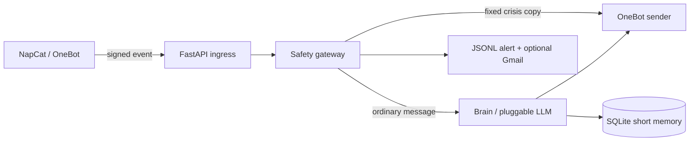

# Companion Bot (W1)

[](https://github.com/hcj050101001/companion-bot/actions/workflows/ci.yml)

A Python and FastAPI OneBot v11 private-message companion bot skeleton, released under the MIT License. Crisis replies always use fixed safety-file copy and never use generated text.

Public name: **阿年**. Default reply model: DeepSeek (third-party). Crisis scheme 2 does not promise notifying a human. Short-term memory can be deleted with “忘掉我”. See `config/onboarding.md` and `config/persona.md`.

## Docs (Chinese)

- [Architecture](docs/architecture.md) · [Roadmap](docs/roadmap.md) · [Contributing](CONTRIBUTING.md) (the former internal handoff doc was removed during open-source sanitization) · [NapCat ops](docs/napcat-ops.md)
- First GitHub publish will be **private**; public release TBD.

## Current status (W1)

Persona `9755c66` closed. E2b `63cefc0`: audit/product/test PASS (avoidant recall 20/20; the internal retest report was removed during open-source sanitization — see the acceptance criteria summary in `docs/e2b-acceptance.md`). Cutover approved; legacy webhook routines stay paused.


## Quick start

```sh
cp .env.example .env
cp config.example.yaml config.yaml
# Set allowed_private_user_ids in config.yaml; export ONEBOT_SECRET and DEEPSEEK_API_KEY in the process environment (not .env)
uv sync
uv run uvicorn main:app --host 127.0.0.1 --port 8090
```

`DEEPSEEK_API_KEY` and `ONEBOT_SECRET` must be supplied through the process environment (not `.env`). Production startup also requires a non-empty `allowed_private_user_ids`, but it no longer restricts private-message admission: all successfully parsed private messages enter the same processing path.

## Architecture



## Configuration

Copy `config.example.yaml` to `config.yaml` and `.env.example` to `.env`. Keep personal account IDs, paths, provider settings, secrets, and action switches in those local files. Providers are `deepseek` (default; key only from process environment), `openai_compatible` (environment variables `OPENAI_COMPATIBLE_BASE_URL`, `OPENAI_COMPATIBLE_MODEL`, and `OPENAI_COMPATIBLE_API_KEY`), and optional `codex`. The Codex provider can expose local Codex credentials; it is not recommended for production.

Gmail SMTP alerting uses `ALERT_EMAIL_TO` and `GMAIL_APP_PASSWORD`. Without the app password it is disabled, while alerts are still written locally first. `ALERT_QQ` is empty by default and enables only redacted crisis reminders. Persona and safety copy can be replaced in `config/persona.md` and `config/safety.yaml`.

## NapCat setup

For the current box runtime (start script with `-q`, ports 3000/5700/8090, out-of-repo relay, paused legacy webhook routine, QQ nickname 阿年), see [docs/napcat-ops.md](docs/napcat-ops.md) (Chinese).

1. Compose runs `mlikiowa/napcat-docker`; set a random `ONEBOT_SECRET` in the process environment (same value as NapCat OneBot token). Sign in through the NapCat WebUI; login data persists in the `napcat-data` volume.
2. The NapCat HTTP API is exposed on local port 3000 and reverse HTTP reports events to companion's `/onebot/event`. Set the same `ONEBOT_SECRET` in NapCat's OneBot HTTP configuration.
4. Verify with synthetic listed and unlisted identities first. Automated tests use a fake NapCat service.

## Safety and risks

Using a third-party protocol client may violate Tencent's User Agreement; you assume the risk. Automated accounts may be restricted or banned. Anyone who sends a private message can enter processing, incur model and search usage, and have short-term history stored locally. Protect credentials and monitor usage. Qzone and friend-management actions are disabled by default; enabled friend management remains pending human confirmation.

The listed hotline configuration applies only in mainland China. Replace it with verified local resources for other regions. Contact local emergency services in an emergency.

## Development

Run `scripts/install.sh`, `scripts/test.sh`, and `uv run ruff check .`. See [CONTRIBUTING.md](CONTRIBUTING.md).

### NapCat watchdog

After installing dependencies, run `uv run python -m companion.ops.watchdog` in a separate terminal. Every 30 seconds it checks the QQ process, the OneBot `get_status` online state, and the API port. On an outage it invokes `NAPCAT_START_CMD` at most once. If service has not recovered after five minutes, it writes a redacted `napcat_down` alert to `logs/alerts.jsonl`; recovery resets the outage state. Set `NAPCAT_BASE_URL` to the NapCat HTTP API and configure `NAPCAT_START_CMD` in the process environment. Start Compose with `docker compose up -d`; for example, run the local watchdog with `NAPCAT_START_CMD='docker compose restart napcat' uv run python -m companion.ops.watchdog`.
