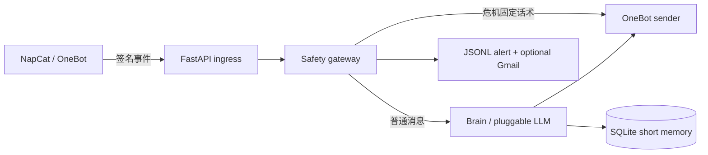

# 阿年 Companion Bot

[](https://github.com/hcj050101001/companion-bot/actions/workflows/ci.yml)

Python + FastAPI 的 OneBot v11 私聊陪伴机器人骨架，使用 MIT 协议。危机回复固定来自安全配置，不交给模型生成。

对外名字：**阿年**（AI 陪伴助手）。默认回复模型 DeepSeek，对话经第三方模型处理。危机默认方案 2：不承诺通知真人，只给热线/110/120。短期记忆可按用户「忘掉这件事 / 忘掉我」删除。首次对话告知见 `config/onboarding.md`，人设见 `config/persona.md`，安全边界见 `docs/persona-safety-v1.md`。

## 文档索引

- [架构](docs/architecture.md)（框架化后现状；W1–W4 旧表述已归档）
- [路线图](docs/roadmap.md)（框架化 P0–P8 阶段状态；首发 **private** GitHub）
- [部署与发布 runbook](docs/deployment-runbook.md)（健康检查、换机恢复、发布与框架线切现网检查单）
- [已接受残留与取舍清单](docs/accepted-residuals.md)（各阶段已记录在案的取舍、未验证项与补审债务）
- [贡献指南](CONTRIBUTING.md)（开发约定、命令与禁止事项；原内部交接文档已在开源清洗中移除）
- [NapCat 本机运维](docs/napcat-ops.md)（`-q`、端口 3000/6099/8090；relay 链路已废弃，见该文顶部注记）
- 人设安全定稿：[persona-safety-v1.md](docs/persona-safety-v1.md)

## 当前进度（框架化 P0–P8 已收口，`v0.9.0`）

- 框架化九个阶段（P0 测试网 → P1 配置 → P2 适配器 → P3 流水线 →
  P4 工具插件 → P5 记忆投递 → P6 关怀接线 → P7 部署资产 → P8 收口）
  已全部完成并打本地 tag **`v0.9.0`**，阶段状态见
  [路线图](docs/roadmap.md)。P0 登记的 15 条已知差异全部关闭，
  全套测试全过、0 xfailed。
- **框架线尚未切现网**：现网仍运行多气泡线版本。切换须按
  [runbook §5](docs/deployment-runbook.md) 检查单另开部署窗口，
  前置含真机冒烟留痕（有留痕才许打 `v1.0.0`）与 Codex 补审清零，
  均须负责人决策，不在框架阶段内代办。
- 历史验收材料（W1 人设线、E2b）的内部报告已在开源清洗中移除；
  验收口径摘要保留在 [`docs/e2b-acceptance.md`](docs/e2b-acceptance.md)，仅作追溯。
- **首发 GitHub private**，公开另议（待实测通过且负责人提供仓库 URL 后再推；不得擅自创建/推送 remote）。


## 快速开始

```sh
cp .env.example .env
cp config.example.yaml config.yaml
# 编辑 config.yaml：allowed_private_user_ids 必须填写自己的测试/授权账号
# ONEBOT_SECRET / DEEPSEEK_API_KEY 只导出到进程环境，不要写入 .env
export ONEBOT_SECRET='<your-secret>'
# export DEEPSEEK_API_KEY='<your-secret>'   # 生产联调时再开
uv sync
uv run uvicorn main:app --host 127.0.0.1 --port 8090
```

`DEEPSEEK_API_KEY` 与 `ONEBOT_SECRET` 只能设置在进程环境变量中，不放入 `.env` 或配置文件（写入也会被忽略并告警）。生产启动必须提供二者与非空 `allowed_private_user_ids`；该配置不再限制私聊准入，所有解析成功的私聊都进入相同处理链路。用 `scripts/install.sh` 安装依赖，用 `scripts/test.sh` 运行测试。

## 开发与扩展

- 跑全套测试：`bash scripts/test.sh`（PATH 需含 `~/.local/bin`，或直接 `uv run pytest -q --timeout=10`）；测试一律走 fake OneBot / FakeAdapter，不连真实 QQ。lint：`uv run ruff check .`。全量套件总覆盖率 89.6%（公开仓 CI 首跑实测，门槛 `fail_under`=85）。
- 新增只读工具：实现 `ToolPlugin` 协议并注册即可，不改 brain/pipeline；最小示例见 [`examples/dummy_tool_plugin.py`](examples/dummy_tool_plugin.py)（骰子插件，契约测试证明注册即生效）。
- 新增平台：实现 `PlatformAdapter` 协议（见 `companion/adapters/`，OneBot 为首个实现、FakeAdapter 为测试实现），业务层只见规范化事件。
- 架构与契约口径以 [docs/architecture.md](docs/architecture.md) 与框架方案（部署根 `plans/2026-10-31-qqbot-framework-architecture.md`）为准；运行观测出口为 `/metrics` 与 `logs/events.jsonl`（含 `tool_step` 诊断记录）。

## 架构



## 配置

复制 `config.example.yaml` 为 `config.yaml`。`allowed_private_user_ids` 仍为必填，但不限制私聊准入；个人 QQ 号、路径、provider 和动作开关只放本地配置。复制 `.env.example` 为 `.env`，可填 NapCat 地址等非密钥项；`ONEBOT_SECRET` / `ALERT_QQ` 用进程环境（`ALERT_QQ` 默认关）。应用通过 python-dotenv 仅从启动命令的当前工作目录加载 `.env` 中的非密钥配置。`DEEPSEEK_API_KEY` 和 `GMAIL_APP_PASSWORD` 只允许从进程环境变量读取；即使写进 `.env` 也会被忽略并在启动时警告。禁止把 `DEEPSEEK_API_KEY` 写入 `.env`。

模型供应方通过 `llm.provider` 选择：`deepseek`（默认，key 仅从 `DEEPSEEK_API_KEY` 进程环境读取）、`openai_compatible`（通过 `OPENAI_COMPATIBLE_BASE_URL`、`OPENAI_COMPATIBLE_MODEL`、`OPENAI_COMPATIBLE_API_KEY` 环境变量配置）或 `codex`。Codex CLI 默认拒绝启动；仅在隔离环境显式设置 `ALLOW_INSECURE_CODEX=1` 才允许启用。

Gmail 告警使用 `ALERT_EMAIL_TO` 和进程环境变量 `GMAIL_APP_PASSWORD`；没有应用密码时邮件默认关闭，告警仍先写 `logs/alerts.jsonl`。配置 `ALERT_QQ` 后才会向该账号发送脱敏危机提醒，空值默认关闭。首次对话告知可替换 `config/onboarding.md`；`config/persona.md` 和 `config/safety.yaml` 也可替换。

首次告知以 `config/onboarding.md` 原文为准（当前为长江定稿短句）。**默认告知义务（不是可选项）**：被问「你是谁 / 用什么模型 / 对话会发给别人吗」时，必须 100% 说清：自己是 AI「阿年」、当前回复模型名（来自 `llm.display_name`）、对话经第三方模型处理；漏答记缺陷。危机「不承诺通知真人」只在危机固定话术中出现，不塞进首次短句。若 onboarding 含 `<!-- third-party -->` 且其后有文案，仅在第三方模型 provider 时追加。`llm.display_name` 经 `{{LLM_DISPLAY_NAME}}` 注入 `persona.md`。`ONEBOT_SECRET` 与 API key 一样禁止从 `.env` 读入，只许进程环境变量。事件去重为落库 claim（键 `(platform, self_id, message_id)`、按道分区、带进程代次），重启后不重复处理、危机话术不重发（框架线口径；现网多气泡线仍为进程内去重，以其发布记录为准）。发送动作受 `tools` 配置中的开关、dry-run 和限流约束；私聊默认按 `requests_per_minute` 对每个用户限流。

## NapCat 对接

当前盒子真实链路运维见 [docs/napcat-ops.md](docs/napcat-ops.md)（`-q` 启动、端口 3000/6099/8090、relay 链路已废弃、账号昵称阿年）。

1. Compose 会使用 `mlikiowa/napcat-docker` 启动 NapCat；`ONEBOT_SECRET` 放入进程环境（与 NapCat OneBot token 一致）。首次登录从 NapCat WebUI 完成，账号数据保存在 `napcat-data` 卷。
2. NapCat HTTP API 映射到本机 3000 端口，反向 HTTP 事件上报发送到 companion 的 `/onebot/event`；在 NapCat WebUI 的 OneBot HTTP 配置中设置同一个 `ONEBOT_SECRET`。
4. 先用合成的白名单及非白名单测试身份验证，再考虑正式使用。测试本身使用仓库内 fake NapCat，不连接真实账号。

### NapCat 守护

安装依赖后，可在独立终端运行 `uv run python -m companion.ops.watchdog`。进程每 30 秒检查 QQ 进程、OneBot `get_status` 的 `online` 状态和 API 端口。故障时最多调用一次 `NAPCAT_START_CMD` 启动命令；连续 5 分钟未恢复后，在 `logs/alerts.jsonl` 写入脱敏的 `napcat_down` 告警，恢复后重置状态。设置 `NAPCAT_BASE_URL` 指向 NapCat HTTP API，并通过进程环境变量配置 `NAPCAT_START_CMD`。

Compose 启动：`docker compose up -d`。本地手动启动守护示例：`NAPCAT_START_CMD='docker compose restart napcat' uv run python -m companion.ops.watchdog`。

## 安全与风险

使用第三方协议端可能违反腾讯用户协议，风险自负。自动化账号存在限制或封号风险。所有发来私聊的用户均可进入处理链路，可能产生模型和搜索费用并在本地保存短期记忆；务必保护凭据并人工监控。默认关闭 QQ 空间和好友管理；危机工具仅可通过显式的 `ALERT_QQ` 出口发脱敏提醒，好友管理只返回待人工确认。

热线配置仅适用于中国大陆；部署到其他地区时，请替换为当地核实过的求助资源。紧急情况联系当地急救或紧急服务。

## 开发

```sh
scripts/test.sh
uv run ruff check .
```

贡献方式见 [CONTRIBUTING.md](CONTRIBUTING.md)。
