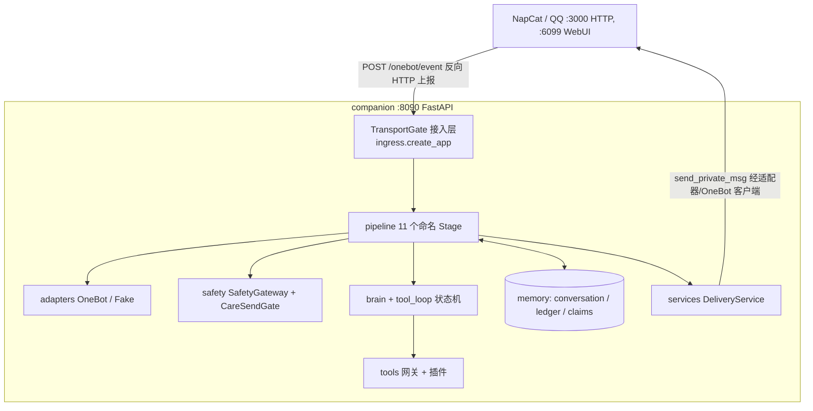

# 架构（框架化后现状）

本文描述 companion「阿年」在框架化 P0–P7 落地后的**当前实际架构**：
以本 worktree 的 `companion/` 代码为准（基线为 P6/P7 合并线
`ai/qqbot-framework-integration2`），
目标布局与实际不一致处在文末逐项注明，不按方案蓝图虚构。方案原文
为部署根 `plans/2026-10-31-qqbot-framework-architecture.md`；运维与
发布见 [deployment-runbook.md](deployment-runbook.md)，阶段状态见
[roadmap.md](roadmap.md)。

安全不变量不在本文复述，指引到定稿文档：人设与危机话术见
[persona-safety-v1.md](persona-safety-v1.md)，安全网关细节见
[safety-gateway.md](safety-gateway.md)，配置与密钥见
[config.md](config.md)，记忆/投递一致性见
[memory-delivery.md](memory-delivery.md)，全部运行时状态的归属见
[state-ownership.md](state-ownership.md)，关怀同意面见
[care-consent.md](care-consent.md)，工具权限见
[tool-permissions.md](tool-permissions.md)。

> 时政口径注记（方案 §3.3）：线上 persona 现行口径为「可作事实性
> 中立摘要、不表态/不劝说/不倡导」；仓库 `AGENTS.md` 仍写「禁止
> 政治话题」。实现按线上口径，本文显式标注该冲突，不静默选边。

## 总览

入口：`main.py` 仅做 `from companion.ingress import create_app` 并
暴露 `app`，uvicorn 以 `main:app` 在 `127.0.0.1:8090` 运行（现网
进程命令行与此一致）。**已移除**：W1 文档中的 relay `:5700`
转发链在当前 `companion/` 代码中不存在——入站由 FastAPI 直接
接收 OneBot 上报、直接验签，不经任何仓内中继进程。（仓外旧盒子
链路的运维记录仍在 [napcat-ops.md](napcat-ops.md) 中，那是部署
环境文档，不描述本包内的数据流；两处口径不要互相冒充。）

## 包结构（实际）

| 包/模块 | 职责 |
|---|---|
| `companion/ingress/` | FastAPI 组装（`create_app`）、TransportGate 接受边界、三道有界队列与消费者、限流、`EventProcessor`（各 Stage 的实际处理段 `_stage_*`）、连接健康接线。`ingress/claims.py` 是进程内 claim 存储（落库实现见 memory） |
| `companion/adapters/` | 平台适配器契约与实现：`base.py`（`PlatformAdapter` 协议、`InboundEvent`、Segment 类型、`Ignore(reason_code)`、`DeliveryHandle`、`SendReceipt` 三态；N6 起 `AdapterCapabilities.action_levels` 声明动作分级面）、`onebot.py`（OneBot 实现：HMAC-SHA1 验签、CQ 解析、`/send_private_msg`、`/get_status` 探活，只许存在于此层）、`fake.py`（`FakeAdapter`，契约/剧本测试底座）。NapCat 全接口接入（N0–N6）后本包另含：`action_registry.py`（191 条登记表，终局处置与五元组）、`gateway.py`（`ActionGateway` 出站单一收口：分级门禁/授权/审计，L3 默认硬禁 + N6 受控解锁）、`actions.py`（9 个类型化门面）、`transport.py`（单一 HTTP 出口）、`resources.py` / `circuit.py`（资源校验与相册熔断）；收口总记录见 [napcat-integration-closeout.md](napcat-integration-closeout.md) |
| `companion/pipeline/` | 命名 Stage 链：`runner.py`（`STAGE_ORDER`、`PipelineRunner`、observer 只读不阻断）、`stages.py`（11 个 Stage 类与 `STAGE_CLASSES`）、`context.py`（`EventContext`） |
| `companion/domain/` | 纯领域层（无 IO、无 companion 内部依赖）：目前仅落地 `claims.py`（分道/分区/状态/`classify_lane` 纯函数）。multipart、repetition、quota 算法尚未迁入，仍在顶层模块（见文末差异表） |
| `companion/services/` | 应用服务层：`delivery.py` 的 `DeliveryService`——额度与并发的唯一记账方，回复/危机/关怀发送经它预留与发送，适配器只作传输；ALERT_QQ 告警经它的 `send_alert` 发送（成功布尔口径、不走额度预留），额度由告警网关自身策略约束。N2 起新增 SendTarget 寻址与 `send_to` 段通道（`segments.py` 段级规划/递归复核）：群目标默认硬关、两级额度由 `SendQuota` 群子桶承载（见 NapCat 接入方案 C8） |
| `companion/brain/` | `CompanionBrain` + LLMProvider 能力声明（`LLMClient.supports_tools`，不再用 `isinstance` 判能力）：`DeepSeekClient`（生产，声明支持工具）、`OpenAICompatibleClient`、`EchoStub`（测试）、`CodexClient`（受 `ALLOW_INSECURE_CODEX=1` 闸门约束，禁止作生产实时 provider）。工具循环诊断由 provider 客户端留在 `last_tool_diagnostics`，Respond Stage 收割后经 pipeline observer 统一出口汇出（§5.10，P8 落地，见下「可观测性」） |
| `companion/tool_loop.py` | 工具循环显式状态机（轮次/调用上限来自配置树 `llm.tool_loop`） |
| `companion/tools/` | 工具网关与插件：`plugins.py`（`ToolPlugin` 协议、`PluginMeta`、注册表、结果 policy `direct`/`synthesize`/`unavailable`）、`read_only.py`（只读工具网关：双开关、闭合 schema、超时、截断、隐私检查、全局信号量）、三只读工具 `current_time.py` / `weather.py` / `web_search.py`、`__init__.py`（动作类 `ToolGateway` 与 OneBot 发送客户端） |
| `companion/memory/` | 存储三端口 + 数据库：`database.py`（`Database`，WAL、`schema_meta.schema_version` 当前 1、启动期迁移）、`conversation.py`（`ConversationStore`：短期历史 40 行窗口（普通回合 2 行；已投递的图片回合 3 行，含 role=vision 识图观察行——筛查 clear 的图片描述经字符类归一（Cf 按危害分治：ZWJ/ZWNJ 保真、其余转义为可见表示；定界符检测在折叠连接符的视图上做、存储保真，上限作用于最终落盘正文（归一/转义/打断之后））与逐行前缀结构隔离后以中性外部素材框架落存、长度上限 2000 字、无 TTL、仅随窗口裁剪）、`user_state`、`pack_preferences`）、`ledger.py`（`DeliveryLedger`：投递状态机与 generation）、`claims.py`（`SqliteClaimStore`：去重 claim 落库，D3）、`care.py`（`CarePreferences`，仓外 0600 SQLite）、`__init__.py` 的 `LongTermMemory` 为 deferred 端口（只定接口、未实现） |
| `companion/safety/` | `SafetyGateway`（关键词 + 模型 judge 双路、固定危机话术、告警分诊断/后果性两类）、`care.py` 的 `CareSendGate`（关怀发送唯一出口、fail-closed） |
| `companion/config.py` | Pydantic 配置树（`AppConfig`，`extra='forbid'`、启动 fail-fast）、`SecretProvider`（密钥只从进程环境按名取）、热更新白名单与审计（`ConfigReloader`，尚未接线周期重读）。详见 [config.md](config.md) |
| `companion/perception/` | 适配器规范化结果到处理链的 `UserMessage` 视图（业务层不读 OneBot 私有字段） |
| `companion/vision.py` | 图片取图/嗅探/视觉服务编排：按引用取图、魔数嗅探图片格式、组装 base64 data URL 并调用视觉模型生成回复；资源口径复用 `adapters.resources` |
| `companion/prompt_packs.py` | 人设包注册与选择（default + friend/reflective/conversational，SHA-256 校验、固定安全包装优先于包文本） |
| `companion/multipart.py`、`companion/repetition.py`、`companion/quota.py` | 顶层纯逻辑存量模块：多气泡拆分/复核（`review_bubbles`、身份披露检查）、重复追问会话、发送额度算法（`SendQuota`）。尚未迁入 `domain/`，语义不变 |
| `companion/scheduler/` | Scheduler 端口 + 进程内实现 + `CareScheduler` 待发队列（P6 已接线并入本线：经 `CareSendGate` 发送、与回复路径共享同一 DeliveryService、撤回即失效；连接健康亦为调度任务）。主动关怀生产开关保持关，触发参数（D2）另立阶段 |
| `companion/ops/` | `connection_health.py`（只读探针：只观察、不控制进程/不登录/不发消息）、`watchdog.py`（仓内 NapCat 探活逻辑；现网进程守护用的是部署资产中的 watchdog，见 runbook §2.4） |

## pipeline：11 个命名 Stage

顺序即契约（方案 §3.1），唯一口径是 `companion/pipeline/runner.py`
的 `STAGE_ORDER`；改序即契约变更，须过顺序契约测试
（`tests/test_pipeline_order_p3.py`，改序即红）。Stage 的实际处理
仍在 `EventProcessor._stage_*` 方法中（搬运而非改写），Stage 类
负责命名、排序与中断语义；observer 只读、抛错被吞、永不阻断。

| 序 | Stage | 职责 | 可中断 |
|---|---|---|---|
| 0 | `TransportGate` | 适配器/入口层先行：验签 → 资格与键提取（无键事件直接 `Ignore`、不建 claim）→ 廉价预筛分道（critical/control/ordinary）→ 容量预留 → 原子建 claim（键 `(platform, self_id, message_id)`）→ 204 入队。单一接受边界：503 只发生在建 claim 之前 | 是 |
| 1 | `Normalize` | 适配器 normalize 结果定型；`Ignore` 带 `reason_code` 落日志后终止 | 是 |
| 2 | `Admission` | 主体分级（owner/consented_friend/stranger/system）× 能力矩阵一次判定写入 `EventContext`；onboarding 首次告知；忘掉/媒体等前置分支（在 judge 与限流之前，保持现行先后；例外：带可取图片引用的纯图片只在此打延期标记，视觉准备在 Respond 于 judge 与限流之后执行——危机话术不被取图 I/O 延迟、图片洪泛先被限流拦下）；关怀控制命令同属此前置分支（P6 接入） | 是 |
| 3 | `SafetyJudge` | 关键词 + judge 双路，任一命中即危机；judge 无明确结论按 D1 保守口径判疑似危机（共 2 次尝试、每次 20s）；危机 → 固定话术经 DeliveryService 的 critical 通道直发并终止 | 是 |
| 4 | `InboundRateLimit` | 入站 6/min/user 滑动窗口；超限静默丢弃 | 是 |
| 5 | `Command` | 风格切换等精确匹配命令 | 是 |
| 6 | `MemoryLoad` | 读短期历史；与 BrainService 共同维护「工具轮次不写记忆」 | 否 |
| 7 | `Persona` | 解析人设快照（默认/风格包 + 安全包装） | 否 |
| 8 | `Respond` | BrainService 工具循环状态机，或确定性工具直达（时间），或多气泡生成 | 否 |
| 9 | `OutputGuard` | 出站复核（身份披露/自伤鼓励/免责），不过回退固定单条；按路由分型：工具直出与搜索合成走各自 guard，不套多气泡上限 | 是（替换为固定回复） |
| 10 | `Deliver` | 多气泡规划（纯函数）→ 额度原子预留 → 节奏发送 → 投递台账记账；额度 0 格静默 | 是 |

并发与过载（P3 落地，饱和测试覆盖）：三道有界队列——普通道
200、control 道 50（与普通道共用 worker 池但优先出队）、critical
道 20（专职执行池）；总预算为普通 worker 池 8 + critical 专职池
2 + 接入层连接级上限；judge 信号量并发 2、等待 ≤5s 超时走 D1；
先 shed 普通生成，永不 shed 关键词危机与撤回类 control 命令；
关停 drain 10s、超时取消并按 ambiguous 记账。

## 数据流（私聊一回合）

1. NapCat 将 OneBot 事件 POST 到 `127.0.0.1:8090/onebot/event`。
2. TransportGate：验签（HMAC-SHA1，非 DEV 缺/错签 401）→ 资格与
   键提取 → 预筛分道 → 容量预留 → 原子 claim（落库）→ 204 入队。
   重复 claim 释放预留、仍回 204；无键/非消息事件 `Ignore`。
3. Stage 链依次执行：Normalize → Admission（主体/能力、onboarding、
   忘掉、媒体前置）→ SafetyJudge（危机则固定话术 critical 直发、
   终止）→ InboundRateLimit → Command → MemoryLoad → Persona →
   Respond（LLM/工具循环/确定性直达）→ OutputGuard → Deliver
   （额度预留、节奏、多气泡或单条直出、台账记账）。
4. 发送经 DeliveryService 与 OneBot 适配器调用 NapCat
   `/send_private_msg`（`:3000`）；回执三态
   accepted/rejected/ambiguous，ambiguous 永不自动重发。
5. 历史只存已接受前缀的投影：台账状态迁移与历史投影在同一个
   SQLite 事务内完成；ambiguous 回合的已接受前缀不进历史。识图
   观察行是唯一非投影历史行：视觉回合结算判定 delivered 后落
   存 role=vision 的描述行（外部素材框架，见上表），不参与台
   账状态机；「忘掉」与危机迟到认领的补偿删除都会将其删净。

## 工具插件（P4）

新增只读工具的成本是一个插件文件 + 一段注册 + 一项配置，不改
brain/pipeline/ingress：插件声明 `PluginMeta` 与独立配置命名
空间，向网关注册；门控（双开关、闭合 schema 校验与保留参数名
拒绝、参数体积上限、全局信号量、统一超时、结果截断、隐私检查
挂钩）由网关统一执行，插件拿不到 identity/sender/gateway。
结果是带 policy 的类型化结果：`direct`（时间/天气确定性直出，
天气署名是结果的一部分、不得剥离）、`synthesize`（搜索回喂
模型合成、无来源清洗、≤5000 字符单条）、`unavailable`（统一
失败形态）。最小示例见 `examples/dummy_tool_plugin.py`。

## 配置（P1）

一个 Pydantic 模型树 `AppConfig`（字段集与 `config.example.yaml`
由契约测试锁死防漂移）：覆盖顺序为模型默认值 < `config.yaml`
（`CONFIG_PATH` 指定优先）< 进程环境（仅 `NAPCAT_BASE_URL` 等
非密钥项）；密钥只经 `SecretProvider` 从进程环境按名读取，
写进 `.env` 的密钥被忽略并告警。旧键 `allowed_private_user_ids`
继续作为正式字段，`care_known_user_ids` 为兼容读别名（两键并存
必须一致）。可热更新的只有白名单功能开关，其余键变更必须重启。
细节与错误口径见 [config.md](config.md)。

## 扩展点

下表为历史扩展点清单：其中 W1–W4 标签已随旧路线图归档（见
[roadmap.md](roadmap.md)），未落地项**不再自动续期**，需要时另立
阶段；与 roadmap 的现行口径冲突时以 roadmap 为准。

| 扩展 | 挂载点 | 默认 |
|------|--------|------|
| Chroma 长期记忆 | `companion/memory` `LongTermMemory` | 只留端口、不实现（已归档决定） |
| 多媒体理解 | Admission 延期放行 + Respond 视觉准备/生成（`companion/vision.py`，deepseek-flash） | `media.vision` 默认开；仅私聊图片且仅识别段数组报文（CQ 串不解析图片段）；语音/视频仍固定回复；图片内容经视觉描述文本在回复生成前过危机网关筛查（Review F7，命中走既有危机协议，随 `media.vision` 开关；随图文字仍在 SafetyJudge 判定，内容安全边界见 `companion/vision.py`） |
| 主动关怀 | `scheduler.CareScheduler` → `safety.care.CareSendGate`（共享 DeliveryService） | P6 已接线、默认关；≤1/天，夜间静默；触发参数（D2）另立阶段 |
| QZone / 好友管理 | `tools` 策略开关 | **默认关**；好友须确认 |
| 群聊 @ | ingress 群聊子链 + `tools.group_chat.reply_enabled` 产品开关 | NapCat 接入 N4 已落地回复通路（仅 @ 触发、双维主体、经 DeliveryService 群通道、不进私聊记忆）；2026-10-31 用户拍板生产开启：默认生产 responder 已接线（空 history、基础人设、不调工具，危机关键词不进群回复），代码默认仍关、生产 config 显式开 |
| 运维面板 | `ops.OpsPanel` | 未排期（历史标签 W4，已归档） |

## 安全边界（架构层，只列结构、细节看指引文档）

- 危机回复永不经 LLM 自由生成：文案只来自 `config/safety.yaml`
  固定模板；告警分诊断（observer、异步）与后果性通知（ALERT_QQ，
  同步有界、话术变体按 `send_alert` 的成功布尔选择）两类，见
  [safety-gateway.md](safety-gateway.md)。
- 对外发送只有一条路：DeliveryService 独占额度与并发记账，
  适配器只是传输；brain/后台任务不得绕过它直发。
- 身份披露双保险：代码侧 `review_bubbles` 拦截 + 无披露回退
  固定文案；身份问题须答全三项（见方案 §3.3 与 P3 确定性用例）。
- 日志与告警只记元数据，正文永不入日志；`EventContext.scratch`
  禁放正文副本到日志。
- 连接健康是只读探针，与进程拉起（systemd/watchdog）严格分工，
  见 [connection-health.md](connection-health.md)。

## 可观测性（现状）

§5.10 统一观测出口已落地（P8）：

- pipeline observer 三件套挂在 runner 上（只读、永不阻断）：
  既有逐 Stage 调试日志、`MetricsObserver`（聚合入进程内
  `StageMetrics`）、`DiagnosticsLogObserver`（工具诊断白名单投影
  后逐条写 `events.jsonl`，`event_type="tool_step"`，字段为
  `trace_id/stage/event_type/result_code/elapsed_ms` + 工具诊断
  字段，正文永不入记录）。
- 工具循环诊断在 Respond Stage 从 provider 客户端
  `last_tool_diagnostics` 收割进 `EventContext.tool_diagnostics`
  后由上述 observer 汇出；聚合与投影都只读白名单字段。
- `/metrics` 文本端点（恒注册、仅回环可达为部署口径）：各 Stage
  调用数/总耗时/最大耗时、工具步计数与成功率、工具循环 token
  （按 model 与按用户哈希聚合，**口径仅限工具循环 respond 步**，
  指标名带 `tool_loop` 前缀）、危机命中计数、发送额度余量
  （`SendQuota.snapshot()` 只读）。用户键为进程盐 HMAC 前 16 位，
  原始 user_id 不入任何聚合与输出。
- 口径限定（TransportGate）：Stage 指标测的是 runner 内 Stage
  耗时；TransportGate 在流水线内是命名占位，真实的验签/容量
  预留/claim 在 webhook 接受边界先行执行，其耗时与 401/503/
  重复 claim 结果不入 Stage 指标，不得据 Stage 指标推断接受
  边界的耗时或拒绝量。
- 已接受的口径限定与残留见
  [accepted-residuals.md](accepted-residuals.md)（R23–R26）；
  裁决过程见 [deployment-runbook.md](deployment-runbook.md) 附录 A。

## 目标布局与实际的差异（如实记录）

方案 §6 的目标布局是收口方向，不是现状：

| 目标布局 | 实际 |
|---|---|
| `core/`、`ports/`、`infra/`、`apps/` 独立包 | 不存在；契约类型分布在 `adapters/base.py`、`brain` 的 `LLMClient`、`config.py` 的 `SecretProvider` 等实现包内，入口组装在 `ingress` 与 `main.py` |
| `domain/` 收齐 multipart/repetition/quota/危机词表纯函数 | 仅 `claims.py` 已迁入；multipart/repetition/quota 仍在顶层 `companion/*.py`，危机匹配仍在 `safety/` |
| `services/` 收齐 safety/brain/persona/delivery/care/health | 仅 `delivery.py`；其余仍在 `safety/`、`brain/`、`prompt_packs.py`、`ops/` 原包 |
| `config/` 包（models/secrets/loader） | 单文件 `companion/config.py` 承担全部三者 |
| `pipeline/stages/` 子包 | 单文件 `companion/pipeline/stages.py` |
| `memory/migrations/` 目录 | 迁移逻辑在 `companion/memory/database.py` 内（additive 迁移），无独立目录 |
| `deploy/` 入仓 | P7 已落地（systemd 模板、runtime 四件套、bin 两脚本与测试）；现网仍用 `runtime-24h/` 现行副本，P8 统一，见 runbook §2.4 |
| `scheduler` 进程内实现 + 关怀接线 | 已落地（P6 并入本线，见上表 scheduler 行）；仅触发参数（D2）未定，属行为参数而非结构缺失 |

以上差异是「未迁完」而非「行为缺失」：行为契约由 P0 剧本与
全套测试锁定，迁移进度以 [roadmap.md](roadmap.md) 为准。
